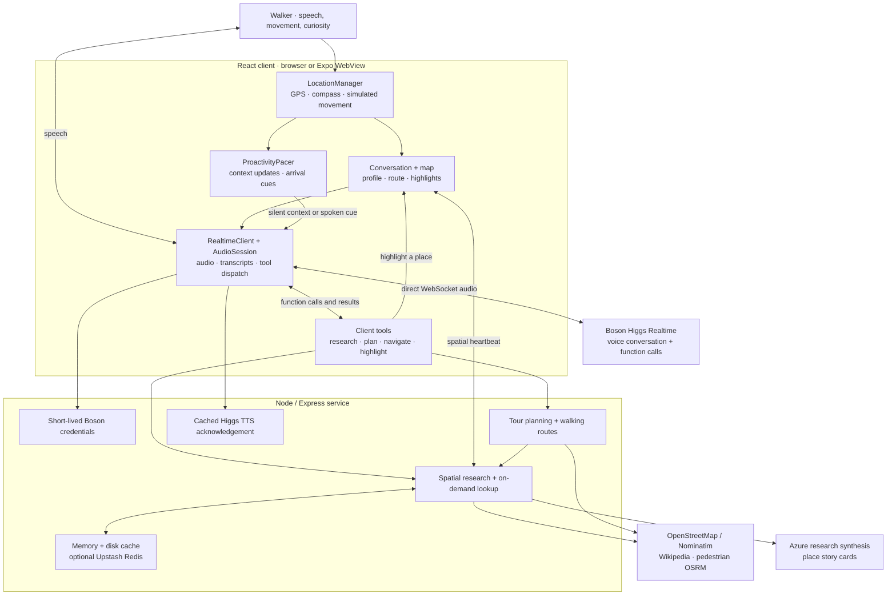
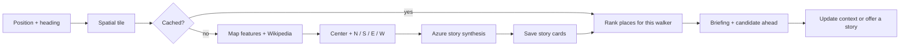

<p align="center">
  
</p>

<p align="center">
  <strong>A local guide in your ears. A conversation shaped by the city around you.</strong><br>
  Built for the Higgs Audio Hackathon 2026 · Primary track: Agents That Act
</p>

<p align="center">
  <a href="#the-experience">Experience</a> ·
  <a href="#architecture">Architecture</a> ·
  <a href="#run-it-yourself">Quickstart</a> ·
  <a href="#try-these-conversations">Try it</a> ·
  <a href="#the-team">Team</a>
</p>

---

## Every street has a story

You arrive in a new neighborhood. There is an interesting building across the street, a café around the corner, and a dozen tabs you could open to learn about them. **RoamAlong turns that exploration into a conversation.**

Tell your guide what interests you, put on your headphones, and start walking. Ask about what is ahead, follow a personal tour, or stop to hear more about something that catches your attention. The guide connects your questions to your location, researches nearby places, and brings the results back into the conversation.

The map provides context. Voice is how you explore.

> **Demo video:** being prepared by the team. Follow the [quickstart](#run-it-yourself) and [example walkthrough](#try-these-conversations) to try the application in the meantime.

## The experience

| Your walk | What RoamAlong does |
|---|---|
| **“I like architecture and unusual local stories.”** | Saves your interests and conversational style to guide place selection and narration. |
| **Wander without an itinerary.** | Researches nearby places and uses proximity and cooldown rules to offer stories. |
| **“What's in front of me?”** | Uses position, heading, and available building geometry to rank candidate landmarks. |
| **Switch to Tours.** | Builds a route targeting eight nearby stops, shaped by your interests and available place data. |
| **“Sounds good, let's go.”** | Recognizes acceptance of the proposed tour and cues the guide toward the current stop. |
| **Ask a follow-up or change language.** | Continues through Higgs Realtime; the guide is instructed to follow the language you speak. |
| **“What is that café known for?”** | Calls place research and can use web search for details beyond the prefetched stories. |

These are example inputs and intended behaviors, not a prerecorded transcript. Answers and available stops depend on the location and research results.

### Two ways to explore

**Wander** lets curiosity set the route. Nearby research supplies a changing set of stories; the guide can speak when you approach a landmark or linger nearby.

**Tours** gives that curiosity a structure. The app gathers your preferences, proposes a walking route, asks for your agreement, and tracks arrival at successive stops. A nearby place can become a short aside without replacing the destination.

**On a phone**, the Expo wrapper supplies native GPS and compass signals. An experimental iOS module adds motion from compatible AirPods to estimate head direction. This is spatial inference from sensors and map data, not camera-based recognition.

## Architecture

Three parts cooperate: **a client that understands movement, a Higgs voice session that conducts the conversation, and a research service that supplies places and routes.**



**Audio travels directly between the client and Boson.** Express mints a short-lived client secret; the permanent Boson key remains on the server. Express handles research, routing, and filler generation rather than relaying the live microphone stream.

### 1. Understand the surroundings

[`LocationManager`](app/src/location/LocationManager.ts) combines location, heading, and walking speed. Desktop debug controls simulate the same inputs. The map subscribes to live movement; larger movement and heading changes update the application state without rerendering the whole interface at every sensor update.

The server groups nearby places into **center, north, south, east, and west** sectors. It combines map features with Wikipedia summaries, asks Azure to synthesize concise story cards, then ranks them by proximity, forward direction, and interests. A story card carries a place identity, coordinates, categories, a sensory hook, and a narrative summary.

### 2. Research ahead of the conversation

[`quadrantOrchestrator.ts`](server/research/quadrantOrchestrator.ts) snaps positions to roughly 150-meter tiles and deduplicates in-flight research. It prioritizes the center and forward sector, then fills the remaining sectors. Movement in Wander mode can trigger research for the next tile in the background.



Cached stories live in memory and `.cache/research-store.json`; optional Upstash Redis makes them reusable across instances. The first request for an uncached tile currently waits for all sectors. Forward-sector priority is a scheduling choice, not a claim of streamed partial results.

### 3. Turn conversation into action

Higgs chooses from seven client function tools and Boson's server-side web search:

| Tool | Result in the experience |
|---|---|
| `save_calibration_profile` | Records interests and style; in Tours mode, starts route generation. |
| `get_spatial_briefing` | Returns nearby stories with relative directions. |
| `deep_dive_poi` | Expands on a landmark using research and Wikipedia context. |
| `lookup_place_reviews_and_facts` | Researches a question outside the current briefing. |
| `highlight_on_map` | Makes the mentioned place visible on the map. |
| `plan_or_update_route` | Builds a guided tour or switches back to wandering. |
| `get_navigation_cue` | Supplies distance and landmark-oriented directions. |
| `web_search` | Runs on Boson's side for information beyond local context. |

The client executes function calls, returns results to the same voice session, and updates the map or route. The research service is a spatial orchestration pipeline; its directional sectors are not independent conversational agents.

### 4. Keep speech connected to the walk

[`ProactivityPacer`](app/src/location/ProactivityPacer.ts) uses arrival distance, movement, heading, dwell time, and narration history to choose between a silent context update and a spoken moment. Guided stops take priority after route acceptance.

[`AudioSession`](app/src/audio/AudioSession.ts) captures and plays audio through AudioWorklets, resampling between the device's rate and Boson's 24 kHz PCM stream. The realtime client filters stale response audio and uses played-audio duration when truncating an interrupted answer. Voice-matched TTS acknowledgements can fill longer tool waits. Caption reveal follows playback progress approximately.

For component responsibilities, request flow, storage, and implementation boundaries, see the [architecture guide](docs/architecture.md).

## Built with Higgs

| Boson component | Its role |
|---|---|
| **Higgs Realtime** · `higgs-realtime` | The voice guide, semantic turn detection, streamed answers, and function calling. |
| **Higgs STT** · `higgs-stt-3.1` | Input transcription for conversation history and spoken tour acceptance. |
| **Higgs TTS 3** · `higgs-tts-3` | A short acknowledgement during slower tool lookups, cached per voice. |
| **Realtime client secrets** | Temporary credentials for client connections without publishing the server API key. |
| **Server-side web search** | Additional facts requested during conversation. |

Higgs handles the conversation and tool decisions. Azure supplies supporting research synthesis. The map, route, and sensor state give the conversation a place in the physical world.

## Run it yourself

### Prerequisites

- Node.js and npm. The web build and offline checks were verified with **Node 24.22.1**.
- A Boson API key with access to the configured Realtime, STT, and TTS models.
- An Azure endpoint, API key, and deployment for research synthesis.
- Internet access for map tiles, place data, Wikipedia, research, and routing.
- A browser with microphone and AudioWorklet support, on **localhost or HTTPS**.

The TypeScript app runs without the earlier Python stack, Docker, Postgres, or Valhalla.

### Install

```bash
git clone https://github.com/PriyanshuDhingra/realtime-conversation-walking-guide.git
cd realtime-conversation-walking-guide
git checkout research-agent
npm ci
```

After this branch is merged, the default branch can be used instead. Install from the repository root, not `apps/mobile`.

### Configure

Create `.env` in the repository root, or add these entries to an existing file. Replace the placeholders with your own values.

```dotenv
BOSON_API_KEY=your-boson-key
AZURE_OPENAI_ENDPOINT=https://your-resource.openai.azure.com/openai/v1/responses
AZURE_OPENAI_API_KEY=your-azure-key
AZURE_OPENAI_DEPLOYMENT=your-deployment-name
```

The research client accepts a full endpoint ending in `/responses`, or a resource base URL for chat completions. **Only the Responses path attaches Azure's web-search tool** for on-demand research; the deployment must support the requested capabilities. See [`azureSynthesizer.ts`](server/research/azureSynthesizer.ts) for the exact request formats.

<details>
<summary>Optional configuration</summary>

| Variable | Purpose |
|---|---|
| `BOSON_API_KEY_FILE` | Read the Boson key from a file instead of an inline value. |
| `BOSON_BASE_URL` | Override the server token/TTS base URL. The client Realtime socket currently uses the Boson URL directly. |
| `AZURE_OPENAI_API_VERSION` | Chat-completions API version; code default is `2025-08-07`. |
| `UPSTASH_REDIS_REST_URL`, `UPSTASH_REDIS_REST_TOKEN` | Enable the shared cache. |
| `PORT` | API port, default `3000`. Update the Vite proxy or frontend API URL if changed. |
| `VITE_API_BASE_URL` | Address of a separately hosted API. |
| `EXPO_PUBLIC_WEB_URL` | HTTPS interface loaded by the native wrapper. |

Keep service credentials in the server environment. `VITE_*` and `EXPO_PUBLIC_*` values are client-visible and must not contain API keys.

</details>

### Start

```bash
npm run dev
```

Open **http://localhost:5173**. Vite serves the interface and proxies `/api` to Express on **3000**. Allow microphone access, start the session, and tell the guide your interests.

Open **http://localhost:3000/api/cache/stats** to check API connectivity. A successful response confirms Express is reachable; it does not verify the external AI services.

<details>
<summary>Windows: missing commands or an API that exits without listening</summary>

If Git, Node, or `cmd.exe` is missing from a PowerShell session, refresh PATH using the standard installation locations:

```powershell
$env:Path = "C:\Program Files\Git\cmd;C:\Program Files\nodejs;$env:SystemRoot\System32;" + $env:Path
$env:ComSpec = "$env:SystemRoot\System32\cmd.exe"
```

The current API entry-point check assumes POSIX path formatting. If `npm.cmd run dev` starts Vite but the API reports completion without listening, stop it and run these in **two terminals**, both at the repository root:

```powershell
# Terminal 1: explicitly start the API
node --import tsx/esm --input-type=module -e "import { createApp } from './server/index.ts'; createApp().listen(3000, () => console.log('API listening on http://localhost:3000'))"
```

```powershell
# Terminal 2: start the interface
npm.cmd run dev:web
```

Restart the explicit API command after server edits. The interface still hot-reloads.

</details>

## Try these conversations

Desktop simulation starts near **700 University Avenue, Toronto**. Open **Settings → Debug tools** to enable location controls. Other presets include SoHo, Montmartre, Gion, and Trastevere; coverage varies by location.

| Step | Action | What to look for |
|---|---|---|
| 1 | In Wander, say “I'm interested in architecture and local history.” | A calibration tool call and a response shaped by those interests. |
| 2 | Ask “What's in front of me?” | A spatial briefing and a corresponding map highlight. |
| 3 | Ask “Tell me more about that building.” | A deeper lookup returned to the conversation. |
| 4 | Switch to Tours and accept the proposal. | A route and a cue toward the first stop. Sparse data may produce fewer than eight stops. |
| 5 | Use simulated walking to approach a stop. | Updated position, route progress, and an arrival story. |
| 6 | Ask a follow-up in another language. | A response in that language; verify with your chosen language and voice. |
| 7 | Interrupt a spoken answer. | Playback stops and the next turn addresses the interruption. Tool-batch interruptions remain limited. |

Debug event logs expose tool calls and session events alongside the spoken result.

### On a real phone

Root [`App.tsx`](App.tsx) is an Expo/React Native shell around the web interface. It requests microphone and location permissions, watches native GPS and heading, and forwards sensor events to the WebView.

Serve the interface and API at phone-reachable HTTPS addresses, then set `EXPO_PUBLIC_WEB_URL` before starting or building the native app. A phone's `localhost` refers to the phone itself. For a separately hosted API, configure `VITE_API_BASE_URL` when building the web interface.

AirPods motion requires a custom iOS build containing [`modules/headphone-motion`](modules/headphone-motion), compatible headphones, and a physical device. Expo Go cannot load that custom module. The repository includes a development tunnel helper (`npm run dev:expo`) and native iOS sources; the helper is development tooling, not deployment, and its subprocess launches need adaptation on Windows.

## Verification

```bash
npm run typecheck
npm run build

# Offline geometry and audio checks
npm test -- -t "Spatial Geometry|Audio Anti-Aliasing"
```

At documentation preparation, type checking, the web production build, and **six offline tests** passed. The build reports a large JavaScript bundle warning. These checks do not establish live voice quality or physical-device compatibility.

`npm test` also includes a live research integration test: it calls external place and Azure services and can use API credits. The full suite was not run for this update. If another checkout sits inside the project, exclude it from Vitest discovery, for example with `--exclude '**/.local/**'`.

## Repository map

```text
app/src/
  App.tsx                  Web application state and coordination
  realtime/                Higgs session, system prompt, tool registry
  audio/                   AudioWorklets, playback, PCM resampling
  location/                GPS/simulation, calibration, proactive timing
  components/              Map, voice controls, debug interface
server/
  index.ts                 Express API
  bosonToken.ts            Ephemeral Realtime credentials
  voiceFiller.ts           Cached TTS acknowledgements
  research/                Spatial pipeline, Azure synthesis, deep research
  osm/                     Place discovery, geocoding, pedestrian routing
  cache/                   Memory, disk, optional Upstash persistence
shared/                    Shared types and geographic calculations
App.tsx                    Native Expo shell and sensor-to-WebView bridge
modules/headphone-motion/  Custom iOS CoreMotion module
ios/                       Native iOS project
test/                      Geometry, audio, and live research checks
tools/                     API probe and Expo tunnel helper
docs/architecture.md       Detailed implementation guide
```

Earlier Python work remains in `backend/`, `apps/`, `pipeline/`, `protocol/`, `db/`, and `tours/`. It has its own runtime and data pipeline. [`IMPLEMENTATION_PLAN.md`](IMPLEMENTATION_PLAN.md) describes that earlier design, not the architecture or setup of the current TypeScript application. Package names and some internal labels still use **Handheld** or **Wander**.

## Prototype boundaries

- **Research:** generated stories and review summaries may contain errors. Source coverage and public-service availability vary; there is no offline research mode.
- **Caching:** geographic tiles reuse stories across preference changes. Prompt changes do not regenerate cached text. Local entries have no expiry; optional cloud entries expire after 30 days.
- **Conversation:** microphone forwarding pauses during client tool batches. Spoken route acceptance uses English phrase matching, even though conversation can be multilingual.
- **Location:** heading and AirPods motion estimate direction, not verified line of sight. GPS uncertainty affects landmark selection and arrival triggers.
- **Delivery:** captions use approximate playback alignment. Native sensors and background operation require device testing. The web build does not bundle or deploy Express.
- **Public hosting:** the prototype API has no user authentication or rate limiting. Add those controls before exposing a deployment backed by paid credentials.

## The team

Built by [Naufal Adityo](https://github.com/nfldty), [Priyanshu Dhingra](https://github.com/PriyanshuDhingra), [Rayan El Ghazzi](https://github.com/rayanelghazzi), and [Alex Khrulev](https://github.com/AlKhrulev).

## Data and acknowledgements

Built with Boson Higgs, Azure research synthesis, React, TypeScript, Express, Expo, MapLibre GL, and AudioWorklets. Map features and place data come from [OpenStreetMap contributors](https://www.openstreetmap.org/copyright); map tiles are served through [OpenFreeMap](https://openfreemap.org/). Summaries come from [Wikipedia](https://www.wikipedia.org/), and pedestrian routes use the [FOSSGIS routing service](https://routing.openstreetmap.de/).

Retain applicable map and content attribution when reusing data. The earlier ingestion pipeline also uses Wikidata; its source notes are in [`pipeline/SOURCES.md`](pipeline/SOURCES.md).
