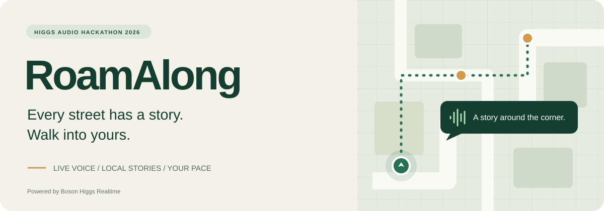
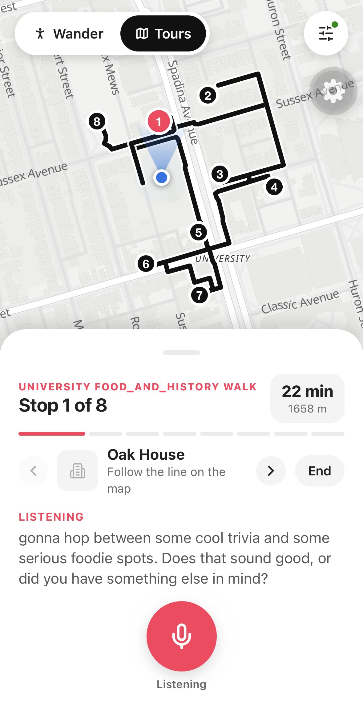
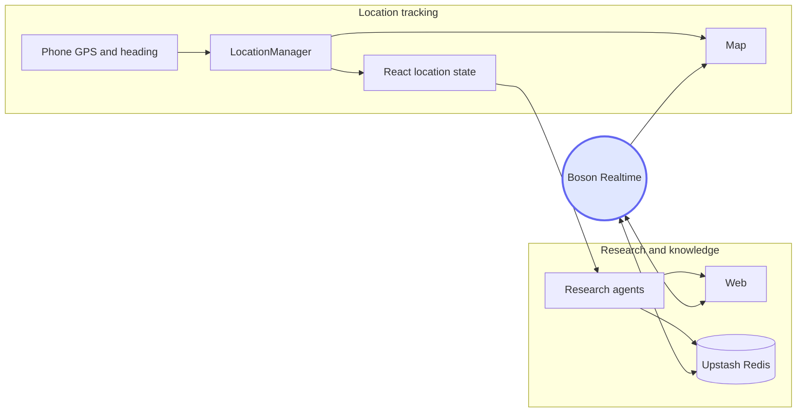

# RoamAlong



RoamAlong is a truly hands-free, real-time, multilingual audio tour experience. You walk with earbuds in. The guide talks about the place you are in, and you can interrupt, change language, or ask about anything nearby. It sees what you see, without needing any camera. It works everywhere in the world.



## What you can do

- Wander freely, or take a guided walk that is adjustable based on your preferences. You can ask the guide to change the plan / detour anytime. It's like your private tour guide !
- Ask for anything the guide doesn't tell you, we made them to be so smart so it can answer anything.
- You can ask about whatever in front of you, thanks to AirPods head tracking capability.
- Interrupt the guide at any time, without losing any context.
- Speak in another language and the guide automatically switches on the next sentence. Boson Higgs Realtime covers 100+ languages.

## Setup

You need Node 20+.

```bash
cp .env.example .env
npm install
```

Fill in `.env` before you start the app. 

### Boson API key

Create a key in the [Boson console](https://www.boson.ai/workspace/) and put it in `.env`:

```bash
BOSON_API_KEY=
BOSON_REALTIME_URL=wss://api.boson.ai/v1/realtime?model=higgs-realtime
```

Restart `npm run dev` after you change `.env`.

### LLM endpoint

We use Azure OpenAI as our default LLM model. In `.env`:

```bash
AZURE_OPENAI_ENDPOINT=
AZURE_OPENAI_API_KEY=
AZURE_OPENAI_DEPLOYMENT=gpt-5-mini
```

`AZURE_OPENAI_ENDPOINT` must end in `/responses`. That is what lets the research agents search the web. Restart the API after you change it.

To use another provider, you can ask your lovely coding agent to edit `callAzureJsonModel` in `server/research/azureSynthesizer.ts`. The chosen model needs to have a web search capability.

### Upstash Redis

Stories and notes are stored in Upstash Redis, one JSON value per place. Add this to `.env`:

```bash
UPSTASH_REDIS_REST_URL=
UPSTASH_REDIS_REST_TOKEN=
```

If the URL or token is missing, stories stay in memory for this run only. So the app will still work, but a restart drops the stories.

### iOS

AirPods head tracking needs the iPhone development build, since it is a native module. The setup is a bit of a pain sorry :(. The first install needs full Xcode, not only the command-line tools, and the iPhone plugged in with Developer Mode on. After the app is on the phone, later runs only need `npm run dev:expo` and the QR code. The cable can stay unplugged.

1. Accept the Xcode license if this Mac has not yet: `sudo xcodebuild -license accept` and `sudo xcodebuild -runFirstLaunch`.
2. Open Xcode → Settings (`Cmd + ,`) → **Accounts**. Add your Apple ID. A free personal team is enough. Select that Apple ID, open **Manage Certificates…**, and add **Apple Development**.
3. Open `ios/HandheldBosonAudioTour.xcworkspace` (the workspace, not the `.xcodeproj`).
4. In the left sidebar, under **TARGETS**, click **HandheldBosonAudioTour**. Open **Signing & Capabilities**. Check **Automatically manage signing**. Set **Team** to your Personal Team. The bundle id is `com.nfldty.handheld-boson-audio-tour`. If Apple says that id is already taken, change it to one you own.
5. Choose your iPhone as the run destination and press **Run** (`Cmd + R`), or from the repo run `npx expo run:ios --device`.
6. On the iPhone, if the app is blocked: **Settings → General → VPN & Device Management**, trust the Apple Development certificate. If Developer Mode is off: **Settings → Privacy & Security → Developer Mode**, turn it on, and restart the phone.
7. Stop the Xcode dev server if it is still running, then start the tour:

```bash
npm run dev:expo
```

That starts the API, the web guide, an HTTPS tunnel, and Expo. Open the **Handheld** app that you just installed and scan the QR code. Do not open Expo Go. Accept the microphone, location, and motion prompts. Put in AirPods Pro, Max, 3, or 4.

### Browser

```bash
npm run dev
```

Open http://localhost:5173. The page is the guide. The API is on port 3000, and the page proxies `/api` to it. There is no AirPods tracking. Direction comes from the compass, or from the GPS course while you are moving.

### Android

```bash
npm run dev:expo
```

Install Expo Go from the Play Store and scan the QR code. The guide opens inside the app. AirPods tracking is skipped. Direction comes from the phone compass or, while you are moving, from the GPS course.

If Expo Go says this project needs a development build, run this once on a computer with Android Studio:

```bash
npx expo run:android
```

After that, the same QR code opens the Android app.

## The Architecture

Boson Realtime is the voice and the orchestrator. It decides when to speak, when to call a tool, and when to stop talking. Behind the scenes, LLM research agents gather information about places ahead of time and store it in a cache. Boson accesses that cache through tools, so it can respond quickly with the information already prepared.

`LocationManager` handles live location tracking. The map subscribes to it directly to update the location dot and camera. React state only updates when you move about 15 metres, turn about 20 degrees, or switch GPS sources. In Debug mode, it also updates after 250 milliseconds. The heartbeat and walking route use these less frequent updates, so the screen doesn’t re-render on every step.



## Some engineering behind

To be able to provide a real tour guide experience. We did some engineering so the model able to provide detailed knowledge while still keeping the conversation realtime.

### Where all the knowledge comes from

OpenStreetMap list all interesting places given the current location. Then, instead of relying on a fixed source like Wikipedia, we run LLM agents in parallel to search the web and put together interesting facts and a short story for each place. That work happens before you ask. Boson only reads what is already stored, keeping the  response fast and natural. If you ask about a place we haven’t researched yet, Boson uses its own web search.

### Prefetching


On a **Tour Mode**, we assume that the user will follow our guide, so the path is known. So the agent researches every place within about 100 m of the walking line, from the start to the end, before you set off.

In **Wander Mode**, user can walk freely, so we have to estimate the user heading direction. The agent researches the 100 m around you first, so there is something to say where you are standing. It then starts another 100 m disk, centered 150 m along your heading, without waiting. Each location update repeats that. Heading direction is inferred by the GPS course.

## Tools Boson can call

| Tool                             | What it is for                                                         |
| -------------------------------- | ---------------------------------------------------------------------- |
| `save_calibration_profile`       | Save the preference you just described.                                |
| `get_spatial_briefing`           | Read the short stories already researched around you.                  |
| `deep_dive_poi`                  | Read the short spoken story for one cached place.                      |
| `lookup_place_reviews_and_facts` | Read the longer sourced notes: dates, reviews, dishes.                 |
| `plan_or_update_route`           | Create a tour, or change the stops or the count.                       |
| `get_navigation_cue`             | Walking direction to the next stop.                                    |
| `highlight_on_map`               | Light the one place being talked about on the UI.                      |
| `web_search`                     | Boson's own web search when the place or the fact is not in the store. |

## Debug mode

During development/testing, we suggest to turn **Debug mode** on in Settings. Three things will appear in the UI  :

- **AirPods orientation.** Yaw, pitch, roll, and the gaze heading. 
- **A joystick.** It can simulates your walk.
- **Chat mode.** we all know you don't want to keep talking during development, hence we add this. The guide will still speak.

## Changing Voice

If you get tired of the same voice, pick another one under **Guide voice**. The spoken name will follows that choice: Mia, Chloe, Marcus, and the rest. Changing it mid-walk switches the sound immediately. 
