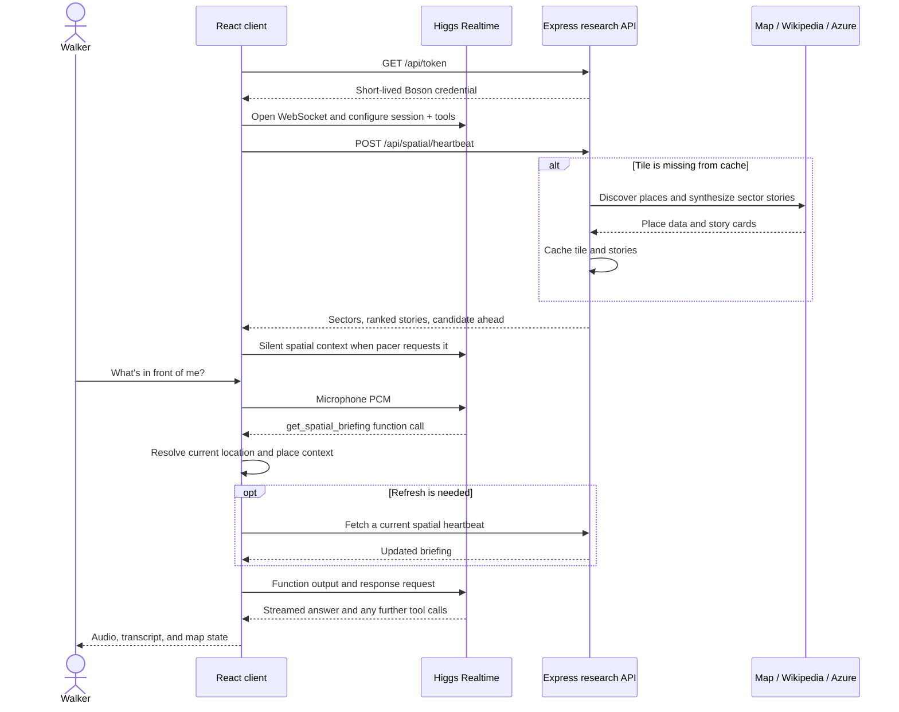

# RoamAlong: implementation architecture

[Back to the showcase README](../README.md)

This guide describes the TypeScript implementation in `app/`, `server/`, and `shared/`, plus the root Expo wrapper. The retained Python application is a separate implementation, not a service required by this runtime.

## One question, end to end

Consider a walker asking, “What's in front of me?” The location system has already supplied a position and heading. Research may already be cached, but the guide can request an updated briefing through a function call.

This illustrates the request boundaries, not a guaranteed model tool sequence. Highlighting is a separate client action, and a model may issue multiple function calls in one response.

## Ownership of state

| State | Owner and lifetime |
|---|---|
| Live position and heading | `LocationManager`; browser GPS, native bridge, or simulation. |
| Interests, voice, mode, and style | React state with browser local-storage persistence. The voice client resets calibration on a new connection. |
| Latest research result | React state/ref containing the latest `SpatialHeartbeatResponse`. |
| Proposed route, current stop, acceptance | Client application and route object; not a durable server-side user session. |
| Conversational turns and model context | The active Boson Realtime session; the client also keeps transcript items. |
| Queued and played audio | AudioWorklet playback state and `AudioSession` counters. |
| Narrated places and cooldowns | `ProactivityPacer` instance. |
| Spatial tiles and story cards | Server memory maps, local JSON, and optional Upstash. |

## Spatial research

[`quadrantOrchestrator.ts`](../server/research/quadrantOrchestrator.ts) coordinates these steps:

1. Snap the position to a roughly 150-meter tile and check the persistent store. A per-tile in-flight map shares work between simultaneous requests.
2. On a miss, reverse-geocode the neighborhood, collect nearby map features, and search Wikipedia. Map discovery uses the OSM map API and Overpass fallbacks, not a private preloaded city database.
3. Enrich selected places with Wikipedia context and assign five directional sectors. An otherwise empty directional sector can reuse a nearby place, so sector membership does not guarantee five distinct sets of landmarks.
4. Reuse existing story cards or ask Azure for structured stories. The center and forward sector are awaited first, followed by the peripheral sectors. The initial HTTP response waits for both groups.
5. Rank stories using score, distance, a forward-direction bonus, and topic matches. Candidate-ahead matching also considers angular span from building geometry where available.
6. In Wander mode, movement can start a lookahead tile fetch asynchronously.

The current candidate-ahead filter considers places within 160 meters and 28 degrees of the heading. Those are heuristics: no camera or visibility model verifies that a building is actually visible.

[`onDemandResearch.ts`](../server/research/onDemandResearch.ts) handles questions outside the tile briefing. It uses a bounded Nominatim place search, a Wikipedia lookup, and Azure synthesis. Azure web search is attached only on the Responses endpoint path. Boson's `web_search` is a separate tool exposed to the conversational agent.

## Guided routes

The default target is eight stops. Planning collects fresh nearby candidates for the chosen topics, deduplicates names, and progressively relaxes spacing constraints to find enough places. Cached stories can supply descriptions; fallback behavior can reuse known places if discovery fails.

Stops are ordered by a nearest-neighbor distance heuristic. The pedestrian OSRM service then supplies the walking polyline, distance, duration, and steps. This is not a globally optimal tour solver and does not guarantee a return to the starting point. At least two stops are required. Wikipedia enrichment is launched asynchronously rather than deliberately blocking route delivery on every article.

After a route is proposed, the client waits for an affirmative user transcript before cueing the walk. English phrase matching drives this transition. On arrival within a stop's configured radius (currently 22 meters), the pacer marks it visited, advances when another stop exists, and produces a narration cue.

## Voice and audio

[`RealtimeClient.ts`](../app/src/realtime/RealtimeClient.ts) owns socket lifecycle, session configuration, event handling, tool batches, transcripts, and response state. [`systemPrompt.ts`](../app/src/realtime/systemPrompt.ts) defines the guide's persona, calibration behavior, language-following instructions, and tool-use policy.

The microphone capture path resamples to 24 kHz PCM. Playback resamples received PCM to the device's audio-context rate. The resampler preserves state across chunks and filters above the target Nyquist limit. AudioWorklets keep capture and playback work off the main UI thread.

On an interruption, the client flushes playback, filters stale response audio, and sends a conversation-item truncation at the amount of audio already played. During client tool batches, microphone forwarding is paused and the interruption handler returns early. This is a known limitation, not fully concurrent listening during research.

Tool calls in a batch execute together, produce function outputs, then trigger a continuation response. A cached TTS line can acknowledge a slower lookup; arriving answer audio replaces that filler. Captions are revealed approximately according to playback progress rather than word-level timestamps.

## Native bridge

Root [`App.tsx`](../App.tsx) loads `EXPO_PUBLIC_WEB_URL` in a WebView. It uses Expo location and audio permissions and forwards native sensor data through `EXPO_NATIVE_LOCATION` and `EXPO_HEAD_TRACKING` messages.

The custom Swift module wraps `CMHeadphoneMotionManager`, emits yaw/pitch/roll samples, and reports whether motion is available. The wrapper combines yaw with a heading to estimate gaze direction. The web `LocationManager` consumes those messages alongside its browser GPS and simulation paths.

Head tracking is iOS-specific and experimental. A custom native build is required; the web app can still operate with heading or simulated location when the module is absent.

## API surface

All routes are defined in [`server/index.ts`](../server/index.ts).

| Method | Route | Responsibility |
|---|---|---|
| GET | `/api/token` | Mint a temporary Boson Realtime credential. |
| GET | `/api/voice/filler` | Generate/reuse a voice-specific TTS acknowledgement. |
| POST | `/api/spatial/heartbeat` | Return current spatial research and ranking. |
| POST | `/api/spatial/deep-dive` | Expand on a named place. |
| POST | `/api/spatial/on-demand` | Research a new local question. |
| GET | `/api/spatial/search` | Search for a place through Nominatim. |
| POST | `/api/tour/generate` | Select stops and construct a guided route. |
| POST | `/api/navigation/walk-route` | Fetch a pedestrian path between coordinates. |
| POST | `/api/navigation/cue` | Produce a relative bearing, distance, and spoken direction. |
| GET | `/api/cache/stats` | Report cache counts and configured cache provider. |

Navigation cues use simple distance and heading calculations; their off-route flag is a distance heuristic, not route-polyline matching. Error handling and validation are uneven across endpoints. The API currently enables CORS and has no user authentication or rate limiting.

## Persistence and service boundaries

- The disk cache loads into memory on first use. Missing entries may then be fetched from optional Upstash; cloud results are copied into local memory and scheduled for disk persistence.
- Writes update memory, schedule a JSON disk flush, and asynchronously write to Upstash when configured. Cloud entries have a 30-day TTL; local entries have no expiry.
- Tile keys are geographic, deliberately omitting profile preferences. POI entries use a mixture of plain place IDs and profile-specific keys. Ranking can respond to new interests while reusing older narration.
- Position and place queries reach external map/research services. Microphone audio goes to Boson. The server's long-lived AI credentials stay outside the browser bundle.
- `npm run build` produces the web assets in `dist/`; it does not create an API server deployment or native binary. A hosted setup must serve the assets, run Express separately, and route `/api` appropriately or configure `VITE_API_BASE_URL`.

## Where to change behavior

| Change | Starting point |
|---|---|
| Guide personality, conversational style, language instructions | [`systemPrompt.ts`](../app/src/realtime/systemPrompt.ts) |
| Add or change a tool | [`tools.ts`](../app/src/realtime/tools.ts), then the corresponding server endpoint |
| Session events, interruptions, continuation after tools | [`RealtimeClient.ts`](../app/src/realtime/RealtimeClient.ts) |
| Research priority, ranking, stop selection | [`quadrantOrchestrator.ts`](../server/research/quadrantOrchestrator.ts) |
| Story prompt and Azure request format | [`azureSynthesizer.ts`](../server/research/azureSynthesizer.ts) |
| New-place research | [`onDemandResearch.ts`](../server/research/onDemandResearch.ts) |
| Proactive timing and arrival behavior | [`ProactivityPacer.ts`](../app/src/location/ProactivityPacer.ts) |
| Native sensor delivery | Root [`App.tsx`](../App.tsx) and [`headphone-motion`](../modules/headphone-motion) |

Reconnect the voice session after changing its system prompt. Research prompt changes will not invalidate cached stories automatically; test with a fresh isolated cache when comparing generated results.
